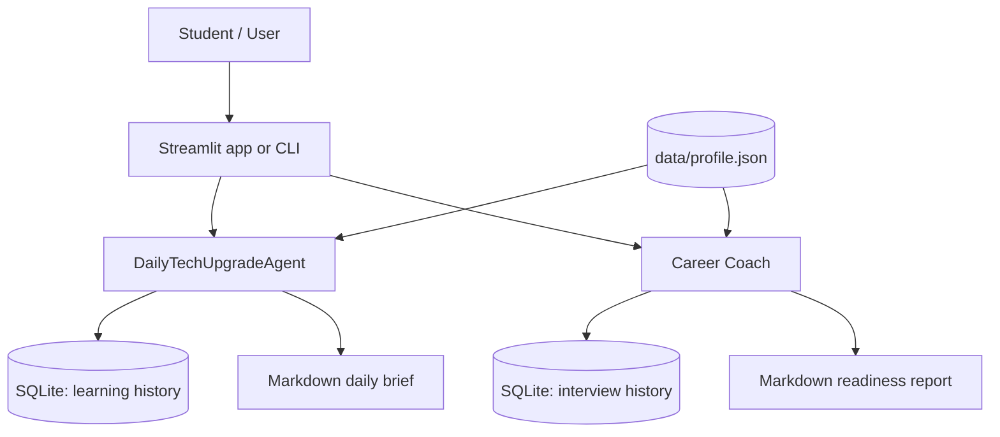
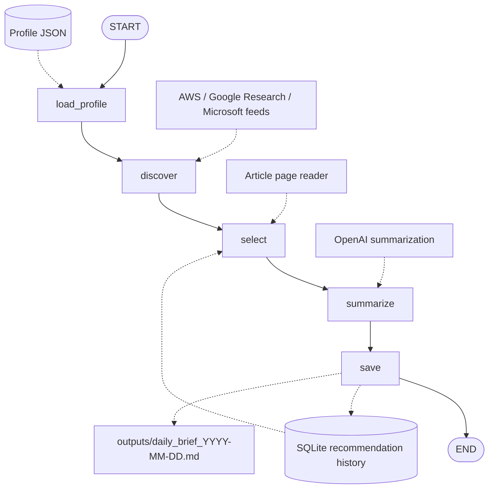
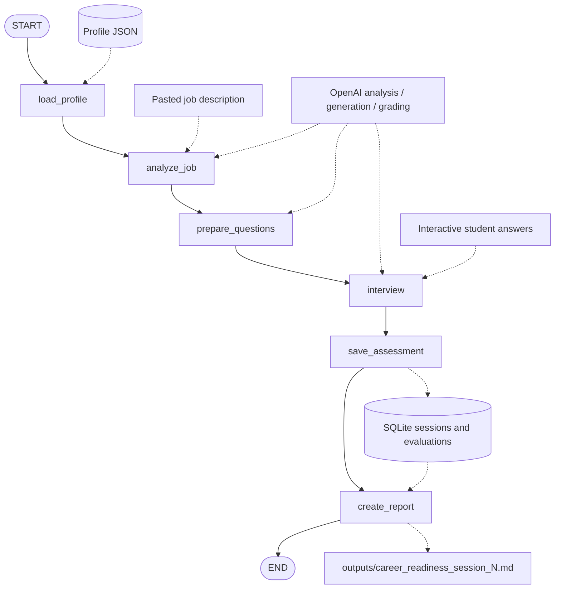

# System Architecture

**Project:** Personal AI Coworkers  
**Author:** Elias Abay · San José State University  
**Implementation:** Python, LangGraph, OpenAI API, SQLite, Streamlit

This project implements two independent AI coworkers that share a local user profile and persistent SQLite-backed memory. The LangGraph implementations use explicit, sequential nodes; model-driven decisions occur inside individual nodes rather than through dynamic graph routing.

## 1. System overview

The agents use external article feeds, web content, job-board endpoints, and LLM-based analysis. The repository also provides command-line evaluation scripts for both agents.

## 2. DailyTechUpgradeAgent: actual LangGraph

Source: `workflows/daily_tech_graph.py`. State type: `TechState` (`profile`, `articles`, `selected_articles`, `daily_brief`). Node names below correspond exactly to the graph definition.

### Node responsibilities

| Node | Function | Inputs / effects |
|---|---|---|
| `load_profile` | Initializes the database and loads personal interests | `data/profile.json` |
| `discover` | Calls `search_articles()` | Article feed metadata |
| `select` | Filters previously recommended URLs, ranks candidates, retrieves content, selects three | `article_exists()`, `calculate_score()`, `read_article()` |
| `summarize` | Generates a personalized brief | `generate_daily_brief()` and user profile |
| `save` | Writes Markdown and recommendation history | `save_article()` and `outputs/` |

**Execution behavior:** `python -m workflows.daily_tech_graph` skips generation when a brief for the current local date already exists. During selection, pages with fewer than 500 characters of extracted content are skipped; a run errors if fewer than three new valid articles remain. Previously recommended URLs are excluded, so the same article is not recommended repeatedly while stored in memory.

**Learning feedback loop:** `learning_feedback.py` records whether a recommended article was read, the student's notes, and a 1–5 self-rated understanding. This is persistent memory, although the current ranking logic is primarily profile-, keyword-, and history-based rather than a learned recommender model.

## 3. Career Coach: actual LangGraph

Source: `workflows/career_graph.py`. State type: `CareerState` (`profile`, `job_description`, `job_analysis`, `questions`, `results`, `session_id`, `average_score`).

### Node responsibilities

| Node | Function | Inputs / effects |
|---|---|---|
| `load_profile` | Initializes local memory and loads the student's profile | `data/profile.json` |
| `analyze_job` | Extracts position requirements and compares them with stated skills | `evaluate_job()` |
| `prepare_questions` | Creates role-relevant interview questions | `generate_questions()` |
| `interview` | Runs interactive questions and AI grading | `conduct_interview()`; answers and follow-up feedback |
| `save_assessment` | Creates session, saves each result, computes mean of primary scores | `career_memory` database functions |
| `create_report` | Writes the latest session report when results exist | `generate_career_report()` |

**Opportunity discovery** is a related feature exposed separately through the opportunity-search tool, `test_opportunities.py`, and Streamlit: it calls public Greenhouse/Lever job boards, classifies relevant internships and fellowships, and supplies role URLs. It is **not currently a node within `career_graph.py`**; the graph begins with a user-provided job description.

## 4. Tools, memory, and interfaces

| Layer | Components | Purpose |
|---|---|---|
| Presentation | `app.py`, CLI runners | Article briefs, job discovery, interview interaction, reports |
| Orchestration | `daily_tech_graph.py`, `career_graph.py` | Deterministic LangGraph execution and state handoff |
| External data | RSS feeds, article pages, Greenhouse/Lever endpoints | Current technical reading and available opportunity metadata |
| AI tools | Article briefing, job analysis, question generation, answer evaluation | LLM-powered natural-language outputs |
| Persistent storage | `memory/database.py`, learning/career memory modules | Recommendation history, read feedback, interview history |
| Configuration | `data/profile.json`, `.env` | Interests, background, API configuration |
| Outputs | `outputs/*.md` | Daily learning briefs and career readiness reports |

## 5. Reliability and security boundaries

- Credentials belong in `.env`, which must not be committed or included in submissions; `.env.example` can document variable names safely.
- External feed pages and job descriptions are untrusted input. Their text should be treated as content, never as instructions for the application to execute.
- Article accuracy depends on successful content extraction, source metadata, and the LLM's fidelity to the retrieved text.
- LLM interview scores are formative feedback; they are not independently validated measurements of professional readiness.
- Local SQLite state is suitable for the course prototype, but it is not a multi-user deployment architecture.
- The daily pipeline uses a fixed sequential graph and local scheduling. It is not an autonomous background service when the user's computer is off.

See [Evaluation](evaluation.md) for recorded measurements, test coverage, and known limitations.
